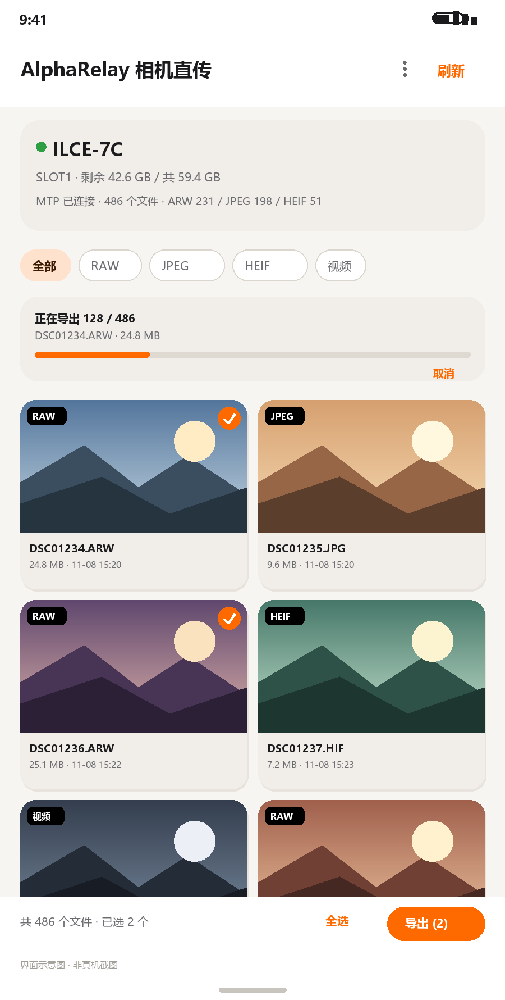

# AlphaRelay 相机直传

给 Sony A7C（以及任何支持 MTP 的相机）用的 Android 工具：**USB 直连相机，实时看卡里的照片，原样导出 RAW / JPEG / HEIF / 视频**。

不经过 Sony 的无线通道，所以不存在"RAW 被转成 JPEG"的问题。



---

## 1. 为什么官方 App 拿不到 RAW

Sony 对 ILCE-7C（A7C）的官方说明写得很明确：

> "RAW images will be converted to JPEG and sent. When [RAW & JPEG] or [RAW & HEIF] is selected, only JPEG or HEIF images will be sent."
> —— [Imaging Edge Mobile: ILCE-7C 发送图像](https://support.d-imaging.sony.co.jp/www/cscs/pmm/page2.php?area=gb&lang=en&mdl=ILCE-7C&abil=33900&mode=transfer)

也就是说无线这条路在协议层就把 RAW 转码了，App 再怎么写也拿不到 ARW。

但 USB 是另一回事：A7C 的 `USB Connection` 支持 `MTP`（见 [A7C 帮助指南 · USB Connection](https://helpguide.sony.net/ilc/2020/v1/en/contents/TP1000115335.html)），此时相机在 Android 眼里就是一个标准 MTP 设备，存储卡里的文件**原样**可见——包括 `.ARW`。这个 App 就是走这条路。

## 2. 功能

| 能力 | 说明 |
| --- | --- |
| 全格式导出 | `.ARW` `.JPG` `.HEIF` `.MP4` `.MTS` 等，按原文件字节导出，不做转码 |
| 相机文件浏览 | 全部/RAW/JPEG/HEIF/视频 筛选，显示尺寸、时间、文件大小 |
| RAW 缩略图 | 只读 ARW 前 6MB，从 TIFF 内嵌预览图里抠出 JPEG，不用下载整张 |
| 大图预览 | 点卡片进全屏，双指缩放 / 拖动 / 双击回正；RAW 自动抠内嵌预览 |
| 重连加速 | 上次的清单和缩略图落盘，重新连接先秒开列表，再后台同步 |
| 即拍即传 | 开着 USB 边拍边导：每 5 秒扫一次卡，新照片自动出现在列表并导出 |
| 批量导出 | 全选/多选，前台服务跑，通知栏看进度、可取消；批次进队列，不会互相打断 |
| 不重复导出 | 按「文件名+大小+修改时间」记指纹，第二次点导出只补新文件；列表里已导过的会标「已导出」 |
| 按日期归档 | 落盘到 `Pictures/AlphaRelay/2026-11-08/` 这样按拍摄日分的目录 |
| 诊断日志 | 出错时菜单里一键看日志并复制，方便排查 MTP 问题 |

## 3. 相机端设置（关键三步）

在 A7C 上先把这两个会抢走 USB 的开关关掉，否则 `USB Connection` 选项是灰的：

1. `MENU → 网络 → Ctrl w/ Smartphone → Off`
2. `MENU → 网络 → PC Remote Function → PC Remote → Off`
3. `MENU → 设置 → USB Connection → MTP`

另外两条建议，长时间导卡时很关键：

4. `MENU → 设置 → USB Power Supply → On`：边连边供电，避免导出到一半电量见底。
5. `MENU → 设置 → Power Save Start Time → 30 min`：相机自动息屏/关机时 MTP 会断，导出就中断了。

然后相机开机、用**支持数据传输**的 USB-C 线连手机（很多线只供电）。手机弹出「是否允许 AlphaRelay 访问该 USB 设备」时勾选「默认用于该设备」再允许。

## 4. 安装

这个仓库里没有放编译好的 APK，需要你自己出一份。**最快的零安装路径见 [BUILD-NOW.md](BUILD-NOW.md)**（浏览器上传到 GitHub，Actions 直接出包）。三种方式任选：

**A. Android Studio（最省事）**

`File → Open` 选本目录，等 Gradle Sync 完，点 Run。需要 Android Studio Koala(2024.1) 或更新（AGP 8.5 要求 Gradle 8.7 / JDK 17）。

**B. GitHub Actions 直接出 APK**

把目录推到 GitHub，`.github/workflows/build-apk.yml` 会自动构建，在 Actions 页面的 Artifacts 里下载 `AlphaRelay-debug-apk`。不需要本地装任何东西。

**C. 命令行**

```bash
# 需要 JDK 17 与 Android SDK（compileSdk 34、build-tools 34）
gradle :app:assembleDebug
# 产物：app/build/outputs/apk/debug/app-debug.apk
```

安装：`adb install -r app-debug.apk`，或把 APK 传到手机点开安装（需允许「安装未知来源应用」）。

**首次构建可能踩的坑**

| 报错 | 原因 |
| --- | --- |
| `Minimum supported Gradle version is 8.7` | 换 Gradle 8.7+，或升级 Android Studio |
| `Failed to find target with hash string 'android-34'` | SDK Manager 里装 Android 14 (API 34) 平台 |
| `Unresolved reference: repeatOnLifecycle` | 少了 `lifecycle-runtime-ktx`（本仓库已声明，别删） |
| `Unresolved reference: setOnCheckedStateChangeListener` | Material 版本低于 1.5（本仓库用 1.12） |
| `Android Gradle plugin requires Java 17` | Gradle JDK 设成 17 |

## 5. 使用

1. 插线 → 授权 → 状态卡显示相机型号和剩余空间。
2. 列表里就是整张卡。**点卡片 = 看大图**（可双指缩放），**长按 = 选中**。
   重新插线时先显示上次的清单（状态栏会写「已显示上次的 N 个文件」），后台同步完成前点大图会提示稍等。
3. 底部按钮：没选就是「导出全部」，选了就是「导出 (n)」。已经导出过的会自动跳过，进度条下面会写「跳过 n 个（之前导过）」。
4. 想边拍边导：右上角菜单 →「即拍即传」。
5. 部分机型插着线拍完，新文件要等相机刷新才可见；列表没更新时点菜单里的「重新连接」。
6. 换了卡、或者想重新导一遍，点菜单 →「清空导出记录」。
7. 出问题时点菜单 →「诊断日志」，可以复制出来发给我。

## 6. 实现要点

- `CameraHub`：`android.mtp.MtpDevice` 封装。所有 MTP 调用串行化到单线程（`mtp-io`），因为 `MtpDevice` 不是线程安全的，一条 USB 会话上并发发 PTP 命令会错乱。
- 枚举：`getObjectHandles(storageId, 0, -1)` 拿根节点，递归到 `DCIM/xxxMSDCF`，按扩展名分类。
- 缩略图：先 `getThumbnail()`；RAW 常返回 null，则 `getPartialObject(handle, 0, 6MB, buffer)` 只读文件头，再用 `PreviewExtractor` 走 TIFF IFD 找 `JPEGInterchangeFormat`（0x0201/0x0202），挑最大的一段 JPEG。找不到就退化成全 buffer 扫描 SOI/EOI。
- 导出：`importFile(handle, ParcelFileDescriptor)` 写到 `cacheDir`，再 `MediaStore` 插入（Android 10+ 用 `RELATIVE_PATH` + `IS_PENDING`；10 以下写公共目录 + 媒体扫描）。
- 长任务：`ImportService`（`dataSync` 前台服务），通知栏进度 + 取消；进度经 `ExportBus`（StateFlow）回传界面。

## 7. 已知限制

- **不支持无线传 RAW。** Sony 的 Wi-Fi 遥控/传输接口只给 JPEG，且没有公开的移动端 SDK；要实现只能逆向 PTP/IP 私有扩展（`sony-pmca` 那类项目），稳定性和速度都不可控。
- **不支持 USB 实时取景 / 遥控快门。** 那属于 `PC Remote` 模式，要么用 Sony 的电脑端 Camera Remote SDK，要么走 HDMI 采集。
- **ARW 缩略图不是免费的。** 每张要读 6MB，几百张的卡滚动时会慢慢加载；已加载的进内存 LRU 缓存。
- 视频不做预览（导出后在相册播放）。
- MTP 传输速度取决于相机固件，A7C 实测通常在 20–40 MB/s 量级；一张 32GB 卡按此估算要 15–30 分钟，所以导出走前台服务，别指望几秒钟。
- 相册索引对 `.ARW` 支持因厂商而异（小米/OPPO 的相册可能不显示 ARW 缩略图），但文件确实在 `Pictures/AlphaRelay/` 里，用文件管理器能看到。
- 只在 Android 8.0+ 上做了适配（`minSdk 26`）。

## 8. 排错

| 现象 | 处理 |
| --- | --- |
| 插上没反应 | 换数据线；相机 `USB Connection` 确认是 `MTP` 不是 `Mass Storage` |
| 一直「等待 USB 授权」 | 系统设置里撤销该 USB 设备的默认授权，重新插；或在开发者选项里关掉「USB 调试」干扰 |
| 列表是空的 | 相机可能还在建会话，点「重新连接」；确认卡已插好；再看「诊断日志」里有没有 `mtp: 枚举完成，共 0 个文件` |
| 导出到一半失败 | 检查剩余空间；「诊断日志」里会有 `download:` 或 `publish:` 的具体异常名 |
| 缩略图全是占位图 | 「诊断日志」里搜 `thumb:`，会写明是 `mtp=0`、`partial 不支持` 还是 `无内嵌预览` |
| 想重新导一遍 | 菜单 →「清空导出记录」 |

## 9. 目录结构

```
AlphaRelay/
├─ app/src/main/java/com/alpharelay/camera/
│  ├─ App.kt                Application、通知渠道
│  ├─ Model.kt              CameraFile、格式分类、尺寸/时间/日期格式化
│  ├─ CameraHub.kt          MTP 会话、枚举、缩略图、下载
│  ├─ PreviewExtractor.kt   TIFF/ARW 内嵌 JPEG 提取
│  ├─ Pipeline.kt           ExportBus、MediaStore 落盘、ImportService（队列）
│  ├─ ExportIndex.kt        已导出文件指纹，防重复导出
│  ├─ ListingCache.kt       上次扫卡清单，重连秒开
│  ├─ Thumbs.kt             缩略图内存 + 磁盘两层缓存
│  ├─ Diag.kt               诊断日志（内存 + 错误落盘）
│  ├─ FileAdapter.kt        网格列表（点击看图 / 长按选中）
│  ├─ PreviewActivity.kt    全屏看图，加载失败会显示原因
│  ├─ PreviewRepository.kt  预览数据源（缓存 → 相机）
│  ├─ PreviewCache.kt       预览 JPEG 缓存
│  ├─ ZoomImageView.kt      双指缩放 / 拖动 / 双击回正
│  └─ MainActivity.kt       USB 授权、列表、选择、导出、即拍即传
├─ app/src/main/res/       布局 / 文案 / 主题 / 图标
├─ tools/                  图标生成、资源一致性检查、ARW 预览算法验证
└─ .github/workflows/      自动构建 APK
```

## 10. 开发状态

源码已通过资源引用一致性检查（`tools/check_resources.py`：XML 合法性、`R.*` 与资源/ID 是否对得上、Kotlin 括号配对）。ARW 预览提取算法用 Python 1:1 移植后跑了构造数据（`tools/verify_preview_extractor.py`：SubIFD、IFD1 链、非 TIFF 回退、截断输入、垃圾输入），全部通过。

但**还没有在真机上编译和运行过**——生成这份代码的环境里没有 JDK / Android SDK。第一次 `assembleDebug` 如果报错，多半是依赖版本或某个 API 签名，按报错改一两行即可。

## 11. 后续可以做的

- 无线：实现 Sony PTP/IP 私有扩展（`sony-pmca` 协议）拿 JPEG 预览 + 触发拍照，RAW 仍然走 USB。
- 电脑桥接：跑一个 Sony Camera Remote SDK 的小服务，手机连它取实时取景画面（真正的取景器串流）。
- 导出时按 `YYYY-MM-DD` 建子目录、跳过重复文件（按文件名+大小+拍摄时间做去重）。
